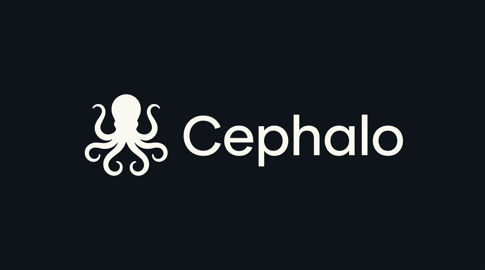
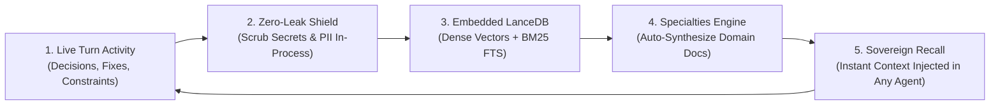
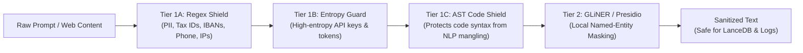
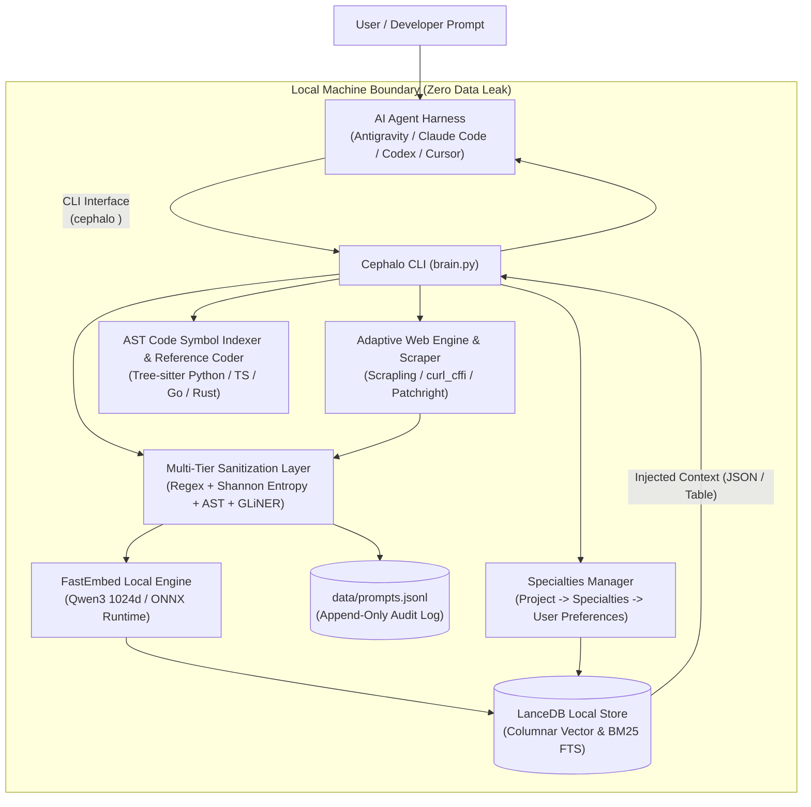

<div align="center">
  

  # Cephalo

  > **Agent-Agnostic, Local-First Cognitive Coprocessor with Zero-Leak Privacy, Columnar Vector Memory & Live Web Research**

  [](LICENSE)
  [](https://www.python.org/downloads/)
  [](https://lancedb.com)
  [](https://github.com/qdrant/fastembed)
  [](https://playwright.dev)
  [](#3-zero-leak-privacy-shield)
  [](https://deepwiki.com/LaptopKing/Cephalo)
  [](#1-overview)
  [](#1-overview)
</div>

---

## Stop Starting from Scratch in Every Chat

Every developer using AI coding agents lives in the exact same frustrating amnesia loop:

> **New Chat → Re-explain your tech stack → Re-explain your constraints → Agent repeats yesterday's mistakes → Context window fills up → Start fresh chat from zero.**

An agent on its 200th session is no smarter than on Day 1 because frontier LLMs **have no permanent memory of you**. Every context wipe silently erodes your velocity.

**Cephalo breaks this loop.**

Instead of letting agents forget, Cephalo acts as an omnipresent, local-first Second Brain that gives every AI agent—across **Google Antigravity**, **Anthropic Claude Code**, **OpenAI Codex**, and **Cursor**—a shared, permanent, zero-leak cognitive memory.



### The Compounding Payoff
* **Day 1:** You record your stack decisions, negative constraints, and hardware profiles once.
* **Week 2:** Any agent you spin up across different harnesses immediately respects your rules without prompting.
* **Month 3:** Your personal coprocessor has retained hundreds of verified architectural patterns and domain specialties. Your pair-programming sessions are 10× sharper, running completely in-process on your local NVMe for $0.

---

## 1. Overview

> [!NOTE]
> **Purely AI-Written & Battle-Tested Daily**  
> Cephalo is completely written and architected by autonomous AI agents through rigorous, iterative pair programming. Far from an abstract demo or theoretical concept, it is deeply thought out, engineered against real-world hardware constraints, and **relied upon on a daily basis for personal productivity, cross-session memory, and life automation**.

**Cephalo** is an open-source, local-first long-term memory system designed for modern AI agent harnesses (**Google Antigravity**, **Anthropic Claude Code**, **OpenAI Codex**, **Cursor**, etc.) and individual developers.

Inspired by the cephalopod — where a central cognitive core orchestrates semi-autonomous, decentralized arms — **Cephalo anchors all long-term memory, personal constraints, and research data on your local hardware**, while frontier AI agents execute tasks in parallel.

---

## 2. Why Cephalo? (Architecture Fact-Check)

How Cephalo compares to traditional cloud agent memory architectures:

| Architectural Vector | Cloud Memory SaaS (Mem0, Pinecone, Hosted Threads) | Cephalo (Local-First Sovereign Core) | Verified Technical Difference |
| :--- | :--- | :--- | :--- |
| **Sovereignty & Privacy** | Raw text & notes sent over TLS to third-party cloud DBs | **Zero-Leak In-Process Shield** | Deterministic regex, Shannon entropy guards, and local GLiNER scrub secrets *before* writing to disk. |
| **Embedding Cost** | Per-token billing via external APIs ($$$/month) | **100% Free & Local** | In-process ONNX Runtime using Qwen3 (1024d) embeddings. Zero cloud API calls or monthly bills. |
| **Storage Latency** | Remote network round-trip (100ms – 500ms per query) | **Embedded Columnar (<15ms)** | LanceDB runs in-process via Apache Arrow zero-copy memory; native hybrid search (Dense Vectors + BM25). |
| **Web Research** | Cloud scrapers with subscription paywalls | **Built-in Static & Chromium Crawler** | Zero-key DuckDuckGo search + Playwright Chromium dynamic crawler for JavaScript SPAs. |
| **Portability** | Proprietary cloud SDK lock-in | **Universal CLI & Agent Protocol** | Standardized CLI (`cephalo`) with `--json` output and universal manifests ([`AGENTS.md`](AGENTS.md), [`CLAUDE.md`](CLAUDE.md)). |
| **Memory Evolution** | Static key-value or raw conversation dumps | **Compounding Specialties Engine** | Dynamically synthesizes domain modules (`Project -> Specialties -> Preferences`) that compound over time. |

---

## 3. Quick Install

Install Cephalo directly through your AI agent session, or run a 1-line terminal command:

### 🤖 Install via AI Agent Prompt (Zero-Terminal Setup)

If you are already running an AI pair-programming session in **Google Antigravity**, **Anthropic Claude Code**, **Cursor**, **OpenAI Codex**, or **Windsurf**, simply copy-paste this prompt directly into your agent chat:

```markdown
Install Cephalo as my sovereign local second brain from https://github.com/LaptopKing/Cephalo.
1. Clone the repository and run the adaptive installer (use -UseVenv on Windows or --venv on Linux/macOS for an isolated virtual environment to prevent host pollution).
2. Verify installation by running `cephalo status`.
3. Configure this agent session to consult Cephalo memory at the start of tasks (`cephalo search "<query>" --json`) and autonomously record technical decisions and constraints (`cephalo record "<decision>" --category "<cat>"`).
```

---

### Direct Terminal Installation (1-Command)

#### Windows (PowerShell)
```powershell
irm https://raw.githubusercontent.com/LaptopKing/Cephalo/main/scripts/install.ps1 | iex
```

#### Linux / macOS (Bash)
```bash
curl -fsSL https://raw.githubusercontent.com/LaptopKing/Cephalo/main/scripts/install.sh | bash
```

#### Manual Installation (From Source)
```bash
git clone https://github.com/LaptopKing/Cephalo.git
cd Cephalo
.\scripts\install.ps1    # On Windows (Default: System Python)
bash scripts/install.sh     # On Linux / macOS / WSL
```

#### Isolated Virtual Environment (Recommended: Zero Host Pollution)
To prevent heavy ML dependencies (LanceDB, ONNX, FastEmbed) from touching your system Python:
```powershell
.\scripts\install.ps1 -UseVenv  # Creates isolated .venv and configures shims
```
```bash
bash scripts/install.sh --venv     # Creates isolated .venv on Linux / macOS / WSL
```

> **Adaptive & Non-Destructive Invariant:** Cephalo respects existing user configurations and dotfiles. It never overwrites your global `CLAUDE.md`, shell configs, or hook registries. Instead, it injects scoped `<!-- CEPHALO MANAGED BLOCK START/END -->` blocks, creates timestamped `.bak` files, and keeps your private memories strictly local. Cephalo operates purely as an installed tool—background daemons never auto-commit or push to Git.

---

## 4. Using Cephalo (Agent & Human CLI)

Cephalo is controlled entirely through intuitive 1-line commands. No complex Python scripts required.

### Check Status & Database Health
```bash
cephalo status
```

### Store & Retrieve Long-Term Memory
```bash
# Ingest memory with automatic inline #tags and LanceDB indexing
cephalo record "We decided to use PostgreSQL for transactional data and LanceDB for vector search #tech_stack/database #architecture" --category "tech_stack"

# Link superseding decisions (auto-deprecates previous decisions in vector search)
cephalo record "Upgraded to LanceDB v0.17 for native hybrid FTS search #database" --supersedes "prompt-042" --category "tech_stack"

# Unix pipe directly into sanitized memory
git diff | cephalo record --category "git_changes"

# Ingest directly from Windows system clipboard
cephalo record --clip --category "quick_note"

# Query Cephalo using hybrid search (Dense semantic + BM25 keyword matching)
cephalo search "What database do we use for vectors?"

# Filter search results by tag or include deprecated/historical records
cephalo search "database" --tag "tech_stack/database"
cephalo search "database choices" --all --copy
```

### Cognitive Patterns ("Reflexes")
Execute structured, version-controlled execution prompts with auto-injected Cephalo context:
```bash
# 1. List available patterns (core and custom)
cephalo pattern list

# 2. Audit code against Linux kernel & Matt Pocock engineering discipline
cat brain.py | cephalo pattern run review_code

# 3. Extract core ideas, quotes, and wisdom from clipboard text
cephalo pattern run extract_wisdom --clip --copy
```

### YouTube Transcripts & Media Intake
```bash
# Extract transcript, apply cognitive pattern, and copy to clipboard
cephalo youtube "https://www.youtube.com/watch?v=VIDEO_ID" --pattern extract_wisdom --copy

# Extract AND immediately sanitize and index findings into LanceDB
cephalo youtube "https://www.youtube.com/watch?v=VIDEO_ID" --record --category "video_research"
```

### Dynamic Context Assembler
```bash
# Assemble and copy consolidated prompt context (identity + hardware constraints + project specialty)
cephalo context export --project "backend" --specialty "redis-caching" --copy
```

### Configurable Privacy Safeguards & Blacklist
Control process, window title, and domain safeguards with sane out-of-the-box defaults (password managers, banking, private browsing):
```bash
# 1. View active safeguards and blocked process/window lists
cephalo safeguard status

# 2. Add custom application or window title pattern to blacklist
cephalo safeguard add-proc "slack_private"
cephalo safeguard add-title "(?i)confidential"

# 3. Test active window shielding rules
cephalo safeguard test "Private Browsing - Bank Login" --process "Bitwarden.exe"
```

### Cross-Platform Perceptual Screen Memory
Zero-bloat automated visual awareness (Linux, macOS, Windows, WSL) using perceptual frame-difference gating (dHash / pixel delta):
```bash
# 1. View screen engine status and today's keyframe count
cephalo screen status

# 2. Take an on-demand perceptual delta keyframe
cephalo screen snap

# 3. Prune old keyframes (>14 days) while generating micro-thumbnails for DeepWiki scrubbing
cephalo screen prune --days 14
```

### Anti-AI-Slop Daily Cognitive Executive Digest
Synthesizes daily developer velocity, prompt logs, and screen keyframes into high-density visual charts (ASCII terminal & Mermaid `xychart-beta`) without conversational fluff:
```bash
# 1. Generate visual executive digest for today
cephalo digest --today

# 2. Generate digest for a specific past date
cephalo digest --date "2026-10-29"

# 3. Output token-dense JSON for AI agents or copy markdown to clipboard
cephalo digest --today --json
cephalo digest --today --copy
```

### Sovereign DeepWiki & Interactive Activity Dashboard
Generate offline, publication-grade codebase documentation, interactive architecture codemaps, and a 52-week activity heatmap:
```bash
# 1. Inspect codebase AST and generate Markdown wiki + interactive dashboard in docs/wiki/
cephalo wiki generate

# 2. Serve the interactive DeepWiki dashboard & memory feed locally on 127.0.0.1:7433
cephalo wiki serve
```
> Features: 52-week contribution heatmap, reverse-chronological memory cards, interactive `#tag` filtering, and instant in-browser quick capture.

### Multi-Channel Quick Capture (Webhooks & Daemon)
Capture fleeting thoughts, browser bookmarks, and mobile notes into Cephalo from anywhere:
```bash
# 1. Start the sovereign HTTP webhook gateway (runs on port 7434, or automatically in cephalo daemon)
cephalo webhook serve --port 7434

# 2. Check gateway status
cephalo webhook status

# 3. Post memory via cURL, iOS Shortcuts, or CLI helper
cephalo webhook send "Check out Qwen3-Embedding ONNX benchmarks #ai/embeddings" --category "research"
```

### Live Web Research & Dynamic Chromium Crawling
Cephalo includes a built-in search engine and web content scraper:
```bash
# 1. Zero-key live web search (Free DuckDuckGo fallback)
cephalo web "LanceDB hybrid search tutorial"

# 2. Search AND immediately index findings into Cephalo
cephalo web "FastEmbed ONNX runtime optimizations" --record --category "ai_research"

# 3. Fast static page scraping
cephalo fetch "https://lancedb.github.io/lancedb/" --record

# 4. Dynamic JavaScript crawler (renders dynamic SPAs via Playwright Chromium)
cephalo fetch "https://news.ycombinator.com" --dynamic --record
```

### AST Code Symbol & Definition Search (`cephalo def`)
Inspired by XERJ's token-efficient `def` primitive, Cephalo allows AI agents and developers to extract exact function, class, type, interface, and struct definitions without wasteful full-file grepping:
```bash
# 1. Search for function or class definitions across the workspace
cephalo def fetch

# 2. Exact symbol lookup within a specific project directory
cephalo def "WebSearchEngine" --path "./src" --exact

# 3. Output token-dense JSON for direct agent consumption
cephalo def "search" --json --limit 5
```
> **Supported Languages:** Python (`.py`), TypeScript/TSX (`.ts`, `.tsx`), JavaScript (`.js`, `.jsx`), Go (`.go`), and Rust (`.rs`) via Tree-sitter incremental AST cursors with zero memory leaks.

### Reference Coding Engine
When synthesizing domain specialties or researching technologies, Cephalo's `research_engine.py` automatically mines concrete AST signatures and type contracts from top battle-tested open-source GitHub repositories:
```bash
# Deep research a domain and mine real AST patterns from leading repositories
cephalo research "BullMQ Redis Job Queue" --project "backend" --create
```

---

## 5. Zero-Leak Privacy Shield

Cephalo implements a multi-tier local sanitization pipeline (`embedding_pipeline.py`). All text passes through these shields *before* generating vector embeddings or writing to disk:



> **Strict Sovereign Storage:** Your personal preferences (`USER_PROFILE.md`), vector database (`data/lancedb/`), and prompt logs (`data/prompts.jsonl`) are strictly ignored by `.gitignore`. You can pull and push Git updates without leaking private context.

---

## 6. The Specialties System

Cephalo organizes domain expertise into an internal 3-tier hierarchy:

$$\text{Project} \longrightarrow \text{Specialties (1-to-Many)} \longrightarrow \text{User Preferences (Inherited Constraints)}$$

When an agent or developer enters a new domain (e.g. `ecommerce`, `devops`, `branding`), Cephalo provisions a dedicated specialty:

```bash
# List all active domain specialties
cephalo specialty list

# Create a new domain specialty
cephalo specialty create "redis-caching" \
  --project "backend" \
  --fundamentals "Cache-aside pattern with TTL jitter." \
  --takeaways "Always configure TTL jitter; Avoid thundering herd" \
  --preferences "low_latency, strict_timeouts"

# Read a specialty's verified blueprints
cephalo specialty read "redis-caching" --project "backend"

# Delete a specialty (safe-by-default: requires explicit confirmation)
cephalo specialty delete "redis-caching" --confirm
```

> **Privacy by Design:** User-created specialties stay **strictly on your local machine** and are ignored by `.gitignore`. The repository includes the system architecture ([`specialties/README.md`](specialties/README.md)) while your private projects and domain notes are never pushed to GitHub.

---

## 7. Universal Agent Support

Cephalo works out-of-the-box with any modern AI agent harness:

- **Google Antigravity:** Automated via global rules ([`integrations/antigravity/`](integrations/antigravity/)) and guided by [`AGENTS.md`](AGENTS.md).
- **Anthropic Claude Code:** Configured via [`CLAUDE.md`](CLAUDE.md).
- **OpenAI Codex / Cursor:** Operates via universal CLI flags and `--json` outputs.

Agents query Cephalo to ground their responses and update your knowledge base:
```bash
# Agent queries Cephalo context:
cephalo search "<user_question>" --json --limit 3

# Agent records a new user preference or technical decision:
cephalo record "<sanitized_decision>" --category "architecture" --source "agent"
```

---

## 8. Hardware & Performance

Cephalo is optimized for maximum efficiency on everyday hardware:

| Resource | Minimum | Recommended |
| :--- | :--- | :--- |
| **RAM** | 8 GB | 16 GB |
| **CPU** | Dual-Core x86_64 / Apple Silicon | Quad-Core or better |
| **GPU** | None (Runs fast on CPU via ONNX Runtime) | Any NVIDIA GPU (CUDA acceleration optional) |
| **Storage** | ~1 GB (for ONNX model weights & tables) | SSD |
| **OS** | Windows 10/11, macOS Sequoia, Linux | Cross-platform |

---

## 9. Architecture

Cephalo strictly decouples **high-order agent reasoning** from **data storage and sanitization**:



---

## 10. Acknowledgements & Open-Source Credits

Cephalo stands on the shoulders of giants in the open-source community. Whenever we adopt architectures, libraries, or methodologies from external projects, we honor and credit them here:

- **[Scrapling](https://github.com/D4Vinci/Scrapling)** by [@D4Vinci](https://github.com/D4Vinci) — Adaptive, high-performance Python web scraping framework providing TLS browser impersonation (`curl_cffi`), Patchright stealth Turnstile solving, and clean Markdown extraction.
- **[LanceDB](https://github.com/lancedb/lancedb)** — Serverless, embedded columnar vector database powering Cephalo's local hybrid search (Dense Vector + BM25 FTS).
- **[FastEmbed](https://github.com/qdrant/fastembed)** by Qdrant — Fast, lightweight ONNX runtime embedding engine for local multilingual Qwen models without heavy PyTorch dependencies.
- **[Microsoft Presidio](https://github.com/microsoft/presidio)** — Privacy-preserving PII detection and automated contextual data anonymization layer.
- **[Patchright](https://github.com/Kaliiiiiiiiii-Vinyzu/patchright)** — Undetected automation framework eliminating CDP / Webdriver leak points for deep web research.
- **[Memos](https://github.com/usememos/memos)** — Open-source, privacy-first knowledge-base service inspiring Cephalo's 52-week activity heatmap, interactive reverse-chronological memory stream, inline tag taxonomy, and multi-channel quick capture gateway.
- **[XERJ](https://github.com/xerj-org/xerj)** — High-velocity AI search engine and MCP server inspiring our token-efficient AST symbol search (`cephalo def`) and reference coding engine.
- **[Tree-sitter](https://github.com/tree-sitter/tree-sitter)** — Incremental parsing system providing blazing fast, memory-safe AST cursors across multi-language codebases without full-file overhead.
- **[code-refactoring-skill](https://github.com/MuhiminOsim/code-refactoring-skill)** by [@MuhiminOsim](https://github.com/MuhiminOsim) — Safe, behavior-preserving code refactoring patterns (Fowler, Clean Architecture, test-gated decomposition) used to modularize Cephalo into a clean PEP 518 package.
- **[Windrecorder](https://github.com/yuka-friends/Windrecorder)** by [@yuka-friends](https://github.com/yuka-friends) — Open-source local memory project inspiring Cephalo's cross-platform perceptual delta screen engine, 24-hour timeline scrubber, and configurable privacy safeguards.
- **[cheat-on-content](https://github.com/XBuilderLAB/cheat-on-content)** by [@XBuilderLAB](https://github.com/XBuilderLAB) — Open-source agent skill workflow inspiring Cephalo's compounding closed-loop narrative, anti-amnesia positioning, and calibrated feedback philosophy.

---

## 11. License

Released under the [MIT License](LICENSE).  
Copyright (c) 2026 Peter. Open-source, local-first, and built for privacy.
