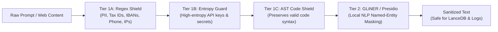
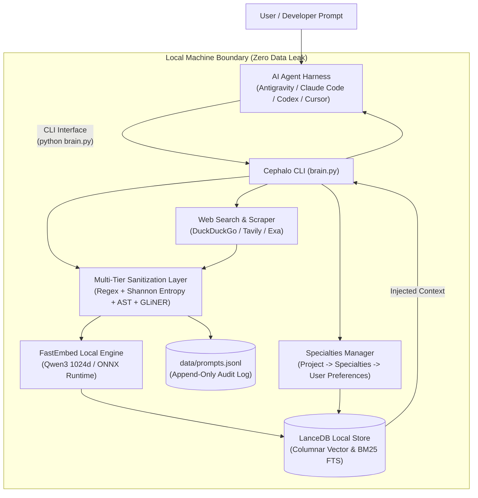

<div align="center">
  

  # Cephalo

  > **Agent-Agnostic, Local-First Second Brain with Zero-Leak Privacy, Columnar Vector Memory & Live Web Research**

  [](LICENSE)
  [](https://www.python.org/downloads/)
  [](https://lancedb.com)
  [](https://github.com/qdrant/fastembed)
  [](#3-zero-leak-privacy-shield)
  [](#8-hardware--performance)
</div>

---

## Table of Contents
- [1. Overview](#1-overview)
- [2. Quickstart Guide (5 Minutes)](#2-quickstart-guide-5-minutes)
- [3. Zero-Leak Privacy Shield](#3-zero-leak-privacy-shield)
- [4. Memory Engine: Record & Hybrid Search](#4-memory-engine-record--hybrid-search)
- [5. Web Search & Research Logic](#5-web-search--research-logic)
- [6. The Specialties System](#6-the-specialties-system)
- [7. Universal Agent Support](#7-universal-agent-support)
- [8. Hardware & Performance](#8-hardware--performance)
- [9. Architecture Overview](#9-architecture-overview)
- [10. License](#10-license)

---

## 1. Overview

**Cephalo** is an open-source, local-first long-term memory coprocessor designed for modern AI agent harnesses (**Google Antigravity**, **Anthropic Claude Code**, **OpenAI Codex**, **Cursor**, etc.) and individual developers.

Inspired by the cephalopod (octopus) — where a central cognitive core orchestrates semi-autonomous, decentralized arms — **Cephalo anchors your long-term memory and personal constraints on your local machine**, while frontier AI agents execute tasks in parallel.

### Why Cephalo?

| Feature | Typical Cloud AI Memory | Cephalo (Local-First) |
| :--- | :--- | :--- |
| **Privacy & Sovereignty** | Sends raw prompts & PII to cloud vector DBs | **100% Local.** Multi-tier sanitizer scrubs PII & secrets before storage |
| **Embedding Engine** | Paid third-party API calls (OpenAI, Voyage) | **FastEmbed ONNX** (Qwen 1024d) running 100% on local CPU/GPU |
| **Search Performance** | High network latency, cloud lock-in | **LanceDB** serverless columnar storage with native hybrid search (Dense + BM25) |
| **Web Research** | Cloud scraping with vendor lock-in | **Zero-key web search & page content scraper** integrated natively |
| **Agent Portability** | Proprietary SDKs locked to one model | **Agent-Agnostic:** Operates via universal CLI & standard manifests (`AGENTS.md`) |

---

## 2. Quickstart Guide (5 Minutes)

Get Cephalo running locally in four simple steps:

### Step 1: Clone & Navigate
```bash
git clone https://github.com/LaptopKing/Cephalo.git
cd Cephalo
```

### Step 2: Install Dependencies
Cephalo requires **Python 3.10+** (Python 3.12 recommended).
```bash
pip install -r requirements.txt
```

### Step 3: Verify Environment
Run the status check to verify LanceDB storage and local FastEmbed embeddings:
```bash
python brain.py status
```
*(On first execution, FastEmbed automatically downloads the lightweight local ONNX embedding model — zero cloud API keys needed!)*

### Step 4: Record & Search Your First Memory
```bash
# Ingest a memory (automatically sanitized and indexed)
python brain.py record "Architecture decision: Use PostgreSQL for transactional data and LanceDB for vector search" --category "tech_stack"

# Query using hybrid search (Dense semantic + BM25 full-text matching)
python brain.py search "What database do we use for vectors?"
```

---

## 3. Zero-Leak Privacy Shield

Cephalo implements a **multi-tier local sanitization pipeline** (`embedding_pipeline.py`). All text passes through these filters *before* touching disk or generating vector embeddings:



- **Protected by Default:** `.gitignore` strictly protects `data/lancedb/`, personal `prompts.jsonl`, user preferences (`USER_PROFILE.md`), and `.env`. You can freely push changes to Git without risking personal data leaks.

---

## 4. Memory Engine: Record & Hybrid Search

All operations are executed via the unified CLI `brain.py`:

### Ingesting Memory (`record`)
```bash
# Save an architectural decision
python brain.py record "We prefer FastAPI over Django for microservices" --category "backend"

# Ingest with explicit intent
python brain.py record "Customer onboarding webhook URL: https://api.example.com/webhook" --category "integrations" --intent "webhook_config"
```

### Hybrid Vector Search (`search`)
Cephalo combines **dense vector embeddings** (FastEmbed Qwen 1024d) with **BM25 keyword matching** in LanceDB:
```bash
# Hybrid Search (Default: Best of both dense semantic & exact keyword)
python brain.py search "FastAPI microservices"

# Machine-readable JSON output (ideal for AI agent pipelines)
python brain.py search "database choices" --json --limit 3

# Full-Text Search only (pure BM25 keyword matching)
python brain.py search "webhook" --type fts

# With SQL metadata filtering
python brain.py search "microservices" --where "category = 'backend'"
```

---

## 5. Web Search & Research Logic

Cephalo includes a built-in **zero-key live web search and webpage scraper** (`web_search.py`). You can research topics on the fly and optionally index verified results directly into your second brain.

### A. Live Web Search
```bash
# Search without requiring any paid API keys (free DuckDuckGo fallback)
python brain.py web "LanceDB hybrid search Python tutorial"

# Return top 3 results in agent-friendly JSON
python brain.py web "Qwen embedding models" --limit 3 --json

# Search AND immediately index sanitized results into LanceDB memory
python brain.py web "FastEmbed ONNX runtime optimizations" --record --category "ai_research"
```

### B. Clean Webpage Ingestion (`fetch`)
Extracts clean, readable text from any webpage (stripping HTML boilerplate, scripts, and navigation) and indexes it into memory:
```bash
# Inspect readable text from a URL
python brain.py fetch "https://lancedb.github.io/lancedb/"

# Fetch, sanitize, and record directly into your second brain
python brain.py fetch "https://fastembed.qdrant.tech/" --record --category "docs"
```

*(Optional: You can add `TAVILY_API_KEY` or `EXA_API_KEY` to `.env` to enable premium AI search engines).*

---

## 6. The Specialties System

The **Specialties System** organizes domain expertise into a structured 3-tier hierarchy:

$$\text{Project} \longrightarrow \text{Specialties (1-to-Many)} \longrightarrow \text{User Preferences (Inherited Constraints)}$$

When starting a project or deep dive (e.g. `ecommerce`, `devops`, `branding`), create a dedicated specialty:

```bash
# List all active domain specialties
python brain.py specialty list

# Create a new specialty with verified fundamentals & bound constraints
python brain.py specialty create "cache-invalidation" \
  --project "backend" \
  --fundamentals "Redis cache-aside pattern with probabilistic early expiration." \
  --takeaways "Always configure TTL jitter; Avoid cache thundering herd" \
  --preferences "low_latency, strict_timeouts"

# Read a specialty's verified blueprints
python brain.py specialty read "cache-invalidation" --project "backend"

# Delete a specialty (safe-by-default: requires explicit confirmation)
python brain.py specialty delete "cache-invalidation" --confirm
```

> **Privacy Guarantee:** All user-created specialties under `specialties/<project>/` stay **strictly local on your machine** and are ignored by `.gitignore`. The repo includes the system architecture ([`specialties/README.md`](specialties/README.md)) while your private projects and domain notes are never committed.

---

## 7. Universal Agent Support

Cephalo works out-of-the-box with any modern AI agent harness without writing custom vendor plugins:

- **Google Antigravity:** Guided by [`AGENTS.md`](AGENTS.md).
- **Anthropic Claude Code:** Configured via [`CLAUDE.md`](CLAUDE.md).
- **OpenAI Codex / Cursor:** Reads universal CLI specifications and `--json` outputs.

Agents interact with Cephalo using standard shell commands:
```bash
# Agent queries Cephalo before making architectural decisions:
python brain.py search "<user_question>" --json --limit 3

# Agent records new user preferences or decisions:
python brain.py record "<sanitized_decision>" --category "architecture" --source "agent"
```

---

## 8. Hardware & Performance

Cephalo is optimized for maximum efficiency on modest hardware:

| Resource | Minimum Requirement | Recommended |
| :--- | :--- | :--- |
| **RAM** | 8 GB | 16 GB |
| **CPU** | Dual-Core x86_64 / Apple Silicon | Quad-Core or better |
| **GPU** | None (Runs seamlessly on CPU) | Any NVIDIA GPU with CUDA support |
| **Storage** | ~1 GB (for ONNX model weights & tables) | SSD |
| **OS** | Windows 10/11, macOS Sequoia, Linux | Cross-platform |

---

## 9. Architecture Overview

Cephalo strictly decouples **high-order agent reasoning** from **data storage and sanitization**:



---

## 10. License

Released under the [MIT License](LICENSE).  
Copyright (c) 2026 Peter. Open-source, local-first, and built for privacy.
