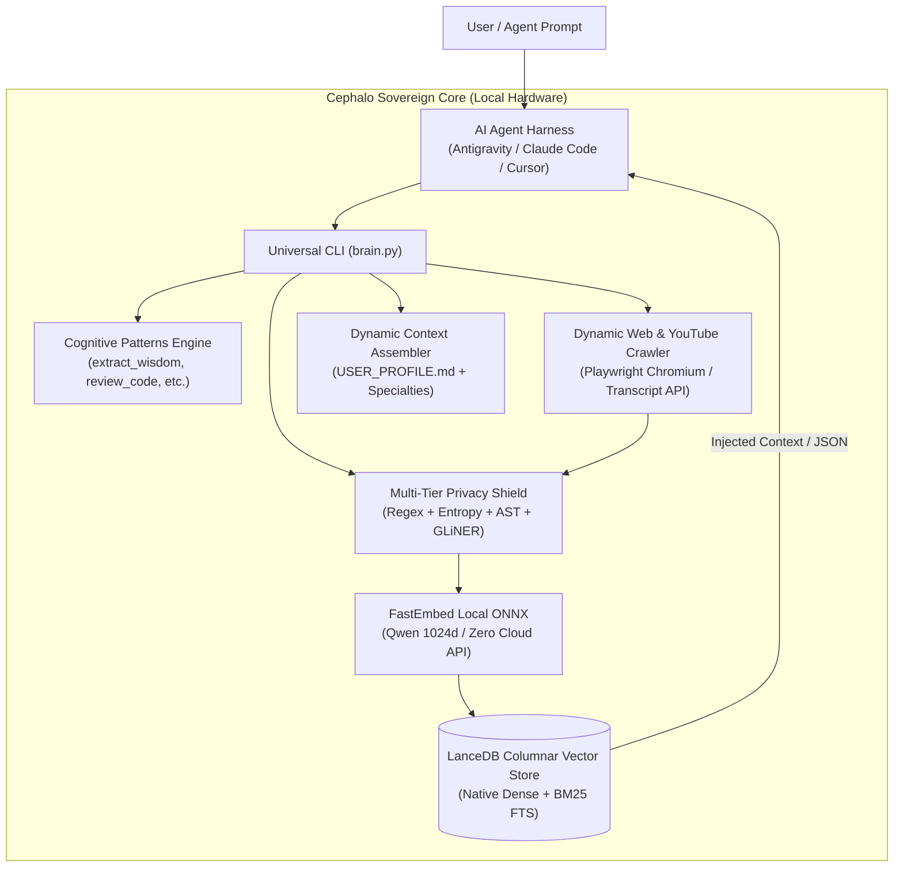

# Cephalo System Architecture

Cephalo strictly decouples **high-order agent reasoning** (Antigravity, Claude Code, Cursor) from **sovereign local data storage, multi-tier privacy scrubbing, and cognitive reflex execution**.

## High-Level Execution Topology

## Key Architectural Principles

1. **Local-First Sovereignty:**
   All vector computations (FastEmbed Qwen 1024d) and tabular storage (LanceDB) execute directly in-process via ONNX Runtime and Apache Arrow zero-copy memory. Zero monthly bills, zero per-token embedding costs, zero data leaving your machine.

2. **Zero-Leak Privacy Shield:**
   Every string ingested into Cephalo passes through a deterministic regex filter (tax IDs, IBANs, Hungarian PII), Shannon entropy guards (stripping high-entropy API tokens), and local named-entity masking before writing to disk.

3. **Unix-Philosophy Ergonomics:**
   All commands support `stdin` streaming (`cat file | cephalo record`), Windows clipboard reading/writing (`--clip`, `--copy`), and structured output (`--json`).
