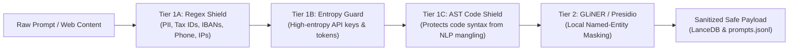

# Zero-Leak Privacy & Sanitization Shield

Cephalo guarantees that private notes, personal details, and sensitive credentials never leak to external model APIs, third-party vector databases, or public repositories.

## Multi-Tier Sanitization Architecture

## Hungarian + English PII Redaction
Cephalo specifically handles:
- **Hungarian Tax Numbers (Adóazonosító):** 10-digit format (`8XXXXXXXXX`).
- **Hungarian IBANs:** Standard 28-character format.
- **Hungarian Phone Numbers:** Mobile and landline formats (`+36 20/30/70 ...`).
- **High-Entropy Tokens:** Base64, hex, and random tokens with Shannon entropy $> 4.3$.
